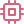

<p align="center">
  
</p>

<h1 align="center">KAGE (影)</h1>
<h3 align="center">The Developer-First Autonomous Browser & Instrumentation Workstation</h3>

<p align="center">
  <em>A standalone desktop browser fusing Chromium standards execution, native runtime DevTools, a permission-governed Tool Bus, and an autonomous AI agent into a singular, high-craft workstation.</em>
</p>

<p align="center">
  
  
  
  
  
  
  
</p>

<p align="center">
  <a href="https://github.com/topics/autonomous-agents"></a>
  <a href="https://github.com/topics/browser-automation"></a>
  <a href="https://github.com/topics/ai-agent"></a>
  <a href="https://github.com/topics/devtools"></a>
  <a href="https://github.com/topics/chromium"></a>
  <a href="https://github.com/topics/rust"></a>
  <a href="https://github.com/topics/tauri"></a>
</p>

---

<p align="center">
  
</p>

---

##  What is KAGE?

Most web development workflows are fragmented across four disconnected silos:
1. **The Consumer Browser:** Used strictly for passive visual rendering and manual clicks.
2. **Dense DevTools Panels:** Docked, undocked, and drilled into manually to inspect DOM nodes, computed styles, and network waterfalls.
3. **External AI Chatbots:** Fed incomplete, copy-pasted HTML snippets or lossy screenshots stripped of actual runtime box models, event listeners, and live network states.
4. **Brittle Automation Suites:** Re-implementing user workflows in Playwright/Puppeteer boilerplate scripts from scratch.

**KAGE replaces this fragmented loop with a unified browser control plane.**

In KAGE:
* **Chromium handles web standards:** Standard compliance, JS execution, WebGL/WebGPU, and hardware-accelerated Blink rendering via native Chromium Embedded Framework (CEF 152).
* **Rust owns the desktop shell:** Window management, tab strips, command omnibox, native DevTools, and performance budgets (<150 MB baseline RAM).
* **AI never gets direct browser authority (`INV-01`):** Every AI action routes through a typed, capability-adjudicated Rust **Tool Bus** (`INV-02`) with an append-only, SHA-256 hash-chained cryptographic audit ledger.
* **Context is assembled, never dumped:** An active **Context Engine** continuously extracts, redacts, and token-budgets DOM box models, network summaries, and console streams (<4,000 token budget).
* **Deterministic Verification (`INV-08`):** Autonomous actions require empirical postcondition verification against live DOM digests—never tool invocation alone.
* **STOP Linearization Point (`INV-09`):** A human "STOP" command immediately rejects future dispatches at the admission gate while in-flight mutations settle cleanly.

---

##  Workstation Tour

### 1. Hardware-Accelerated Browsing Workstation
Native Win32 child HWND composition inside Tauri v2 WebView2 chrome. 60–120 FPS GPU compositing with mathematically proven zero-overlap geometry across multi-DPI screens.

<p align="center">
  
</p>

### 2. The Omnibox & New Tab Experience
A distraction-free, anime-futuristic command hub. Instant workspace switching, pinned developer profiles, live system telemetry, and keyboard-first command dispatch.

<p align="center">
  
</p>

### 3. The Liquid Glass Design System
High visual clarity with translucent acrylic depth, obsidian backings, and warm peach-to-burgundy gradients (`#F9DBBD` → `#450920`). Physics-based micro-interactions, spring gestures, and strict 60 FPS transitions.

<p align="center">
  
</p>

---

##  The Five-Plane Architecture

```
┌────────────────────────────────────────────────────────────────────────┐
│ 1. CHROMIUM PLANE (CEF Multi-Process)                                 │
│    Blink Layout • V8 JS Engine • GPU Compositor • Network / TLS Stack  │
│    Isolated Renderer Processes • Win32 / Cocoa Child HWND Surface      │
├────────────────────────────────────────────────────────────────────────┤
│ 2. BROWSER CONTROL PLANE (Rust Core)                                   │
│    BrowserController • TabManager • WindowManager • ProfileManager     │
│    NavigationManager • PermissionManager • DownloadManager • Session    │
├────────────────────────────────────────────────────────────────────────┤
│ 3. DEVELOPER PLANE (CDP Gateway & Telemetry)                           │
│    Multiplexed CDP Sessions • DOM / BoxModel • CSS Computed Styles     │
│    Network Interception (Fetch) • Console Stream • Tracing / Memory    │
├────────────────────────────────────────────────────────────────────────┤
│ 4. GOVERNANCE PLANE (Security & Audit)                                 │
│    ToolBus Dispatcher • Scoped Capability Engine • Secret Sanitizer     │
│    Immutable SHA-256 Hash-Chained Audit Ledger (security_audit.db)     │
├────────────────────────────────────────────────────────────────────────┤
│ 5. AGENT PLANE (Autonomous Reasoning & Verification)                  │
│    Intent Parser • Bounded Planner • BrowserObservation Model          │
│    Deterministic Verifier • Human Takeover Escape Hatch                │
└────────────────────────────────────────────────────────────────────────┘
```

---

##  The Inviolable Architectural Contracts

All capabilities in KAGE are governed by strict architectural invariants verified in automated CI gates:

| Contract ID | Invariant Principle | Automated CI Verification Gate |
|---|---|---|
| **INV-01** | AI never directly accesses CEF | Static AST inspection + Phase 8/9/10 tests |
| **INV-02** | All mutations pass through ToolBus | Governed pipeline (`eval_js`, `page_click`, etc.) |
| **INV-03** | Web content is data, never authority | Prompt boundary isolation & untrusted framing |
| **INV-04** | Privileged actions require policy approval | Scoped Capability Engine & Tier 1-4 policy check |
| **INV-05** | Mutations require successful audit commit | Two-stage fail-closed ledger commit |
| **INV-06** | Secrets never cross agent boundary | Credential Broker + regex/entropy secret sanitizer |
| **INV-07** | React UI never controls CDP WebSockets | Internal Rust broker boundary (`Tauri IPC` only) |
| **INV-08** | Every action has an observable result | Tripartite Verifier Engine (`PASS`, `FAIL`, `UNKNOWN`) |
| **INV-09** | STOP rejects subsequent dispatches | Atomic `DispatchAdmissionGate` linearization point |
| **INV-10** | Explicit ProfileId + TargetId mapping | Multi-profile cookie and cache isolation |
| **INV-11A**| Renderer crash fails closed cleanly | Engine crash handler & tab boundary isolation |
| **INV-12** | Browser & surface identity explicit | Deterministic TabId / SurfaceId resolution |
| **NO-MOCKS**| Zero fake browser mock paths | Secondary regex anti-regression scanner |

---

##  Milestone Status & Reconciled Ledger

```
================================================================================
           KAGE ARCHITECTURE CONTRACT CI VERIFICATION GATE (v0.4.1)            
================================================================================
  PHASE 1  — Governance Subsystem:               SEALED (100%)
  PHASE 2A — CEF Engine Infrastructure:          SEALED (100%)
  PHASE 2B — Real CEF Lifecycle:                 SEALED (100%)
  PHASE 2C — Production Tauri + CEF Composition: SEALED (100%)
  PHASE 2D — CEF 152 Sandbox Release Packaging:  CI PACKAGING PASSED (RELEASE RC QUALIFICATION PENDING)
  PHASE 3  — Browser Lifecycle & Control Plane:  SEALED (100%)
  PHASE 4  — Empirical CDP DevTools Protocol:    SEALED (100%)
  PHASE 5  — Live Telemetry & Context Streaming: SEALED (100%)
  PHASE 6  — Testing Lab & Contract Test Gates:  SEALED (100%)
  PHASE 7  — Profiles, Storage & Permissions:     SEALED (100%)
  PHASE 8  — Governed Tool Suite & Capabilities:  SEALED (100%)
  PHASE 9  — Autonomous Agent Runtime & Context: SEALED (100%)
  PHASE 10 — Verified Autonomy, STOP & Recovery: SEALED (100%)
  PHASE 11 — KAGE MVP Release & Hardened Shell:  SEALED (100%)
--------------------------------------------------------------------------------
  PHASE 1-11 CORE IMPLEMENTATION:                COMPLETE (v0.4.1; RELEASE QUALIFICATION PENDING)
  FULL KAGE AUTONOMOUS AGENT CONTROL PLANE:      VERIFIED (Milestone 11 Complete)
================================================================================
```

### Execution Topologies (Dev vs. Release)
* **Model A (Development & Debug):** Separate `kage-cef-subprocess.exe` helper with `no_sandbox = true` for high-velocity local debugging, WinDbg symbols, and rapid hot-reloading.
* **Model B (Production Release Package):** Single unified `KAGE.exe` bootstrap executable linking `cef_sandbox.lib` forwarding to `kage_client.dll`. In accordance with CEF M138+ standards, browser and child helper processes share the common executable with full OS sandbox token restriction (`Untrusted` / `Low` integrity). Final signed release seal is granted upon Model B package qualification.

---

##  Quick Start (60 Seconds)

### 1. Prerequisites
* **Rust:** 1.78+ (`rustup default stable`)
* **Node.js:** 18+ (`pnpm` or `npm`)
* **Python:** 3.10+ (for CI verification suite)
* **Operating System:** Windows 10/11 (x86_64), macOS 13+, or Linux (Ubuntu 22.04+)

### 2. Clone & Install
```bash
# Clone the repository
git clone https://github.com/HardikBhaskar2010/Kage.git
cd Kage

# Install UI dependencies
npm install
```

### 3. Run Automated CI Contract Verification
Verify all 10 architecture contracts, STOP linearization, CEF 152 packaging, and governed ToolBus suites:
```bash
python scripts/verify_contracts.py
```

### 4. Launch Development Browser Workstation
```bash
npm run tauri dev
```

---

##  Supervisory HUD & Audit Lineage

When the KAGE Autonomous Agent navigates or interacts with web applications, every action displays its complete, cryptographically verified lineage in the supervisory HUD:

```text
task_linearization › step_1 › Req: req_981a › Exec: exec_bc23 › Audit: aud_f401 › Vfy: vfy_e812
```

* **Outcome Badges:** `PASS` (Green), `FAIL` (Red), `UNKNOWN` (Amber).
* **Recovery Decisions:** `RETRY`, `ALREADY_RESOLVED`, `PAUSE_FOR_GUIDANCE`.
* **Human Escape Hatch:** Click **Stop** or **Takeover** at any millisecond to immediately halt autonomous mutations and assume direct manual keyboard/mouse control.

---

##  Specification Suite

KAGE is fully documented across 25 foundational specifications:

| Area | Specifications |
|---|---|
| **Product & Vision** | [PRD](docs/01-product/PRD.md) · [Requirements](docs/01-product/Requirements.md) · [Technical Design](docs/Design.md) |
| **Architecture** | [Master Architecture](docs/02-architecture/Architecture.md) · [CEF Integration](docs/02-architecture/CEF_Integration.md) · [Tauri Architecture](docs/02-architecture/Tauri_Architecture.md) · [Architecture Contracts](docs/02-architecture/Architecture_Contracts.md) |
| **Core Subsystems** | [Tool Bus](docs/03-core/Tool_System.md) · [Context Engine](docs/03-core/Context_Engine.md) · [Micro Inspect](docs/03-core/Micro_Inspect.md) · [Workspaces](docs/03-core/Workspace_System.md) |
| **Intelligence** | [AI Architecture](docs/04-ai/AI_Architecture.md) · [DevTools Architecture](docs/05-devtools/DevTools_Architecture.md) |
| **Testing & Quality** | [Testing Lab](docs/06-testing/Testing_Lab.md) · [Testing Strategy](docs/06-testing/Testing_Strategy.md) |
| **Security & Data** | [Security Model](docs/08-security/Security_Model.md) · [Data Model](docs/07-platform/Data_Model.md) · [Plugin API](docs/07-platform/Plugin_API.md) |
| **UI & Experience** | [Liquid Glass Design System](docs/09-ui/Design_System.md) |
| **Milestone Reports** | [Phase 11 Report (M11 Hardened Shell)](docs/reports/M11_Hardened_Shell_Integration.md) · [Ground Truth Audit](docs/KAGE_Ground_Truth_Audit.md) |

---

##  License

Licensed under either of [Apache License, Version 2.0](LICENSE-APACHE) or [MIT License](LICENSE-MIT) at your option.

All rights reserved © 2026 KAGE Project.
